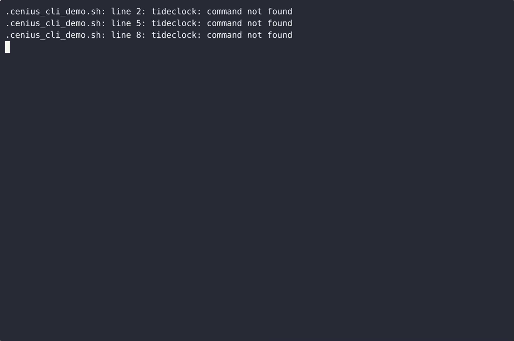

# TideClock — complete Full-stack app command-line tool example app

This repository contains the complete source for **TideClock**, an open-source command-line tool built with Full-stack app. TideClock is a single-file, standard-library-only Python CLI that predicts water height at a bundled harbor from harmonic constituents, reports the moon phase for any date, and plans safe harbor windows from a vessel'…. Everything TideClock needs to run is here — code, seed data, install scripts. Apache-2.0-licensed — use TideClock commercially, self-host it, or [remix TideClock on cenius.ai](https://cenius.ai/marketplace/p/tideclock?ref=gh&utm_campaign=tideclock-webapp) to make it yours.


[](LICENSE)  [](https://cenius.ai)

[](https://cenius.ai/marketplace/p/tideclock?ref=gh&utm_campaign=tideclock-webapp)

> **▶ [Open & edit in cenius.ai](https://cenius.ai/marketplace/p/tideclock?ref=gh&utm_campaign=tideclock-webapp)** — one click to an editable workspace: describe changes in plain English, get an instant preview, one-click deploy and host. Modifications made on the platform come with full rebrand & relicense rights.

_Local clone? See [Quick start](#quick-start) below. cenius.ai is the zero-setup path._

## Demo


📽 **[Demo video on cenius.ai](https://cenius.ai/marketplace/p/tideclock?ref=gh&utm_campaign=tideclock-webapp)** — the complete run-through · [MP4](.github/media/demo.mp4)

## Screenshots



## Features

- Harmonic tide predictor
- Moon phase tracker
- Safe harbor window planner

## Quick start

```bash
./install.sh   # installs dependencies + seeds demo data
```

See [`INSTALL.md`](INSTALL.md) for full setup and usage instructions.

## Architecture

No external services required: the entire command-line tool runs from this Full-stack app repo (22 files). Top-level layout: `tests/`. The setup script (`install.sh`) installs runtime dependencies and loads a starter dataset so the app is immediately usable. Step-by-step setup guide: [`INSTALL.md`](INSTALL.md).

## Usage guide

Three commands, one job each. Everything below runs offline; there is no account, no
configuration, and no server.

- [`tideclock tide`](#tideclock-tide) — hourly tide heights
- [`tideclock moon`](#tideclock-moon) — phase, illumination, 7-day outlook
- [`tideclock harbor`](#tideclock-harbor) — safe harbor windows for a draft
- [Scripting with `--json`](#scripting-with---json)
- [Errors, streams, and exit codes](#errors-streams-and-exit-codes)

All examples assume `tideclock` is on your `PATH`; if it is not, replace `tideclock` with
`python3 tideclock.py`.

---

### `tideclock tide`

```bash
tideclock tide --station "Cape May, NJ" --date 2025-06-01
```

```
 Time     Height  Profile                 Trend
──────────────────────────────────────────────────────────────────────────────
 00:00    0.59 m  ████████████████████    falling
 01:00    0.48 m  ██████████████████··    falling
 ...
 12:00    0.60 m  ████████████████████    rising
 ...
 23:00    0.45 m  ██████████████████··    rising
──────────────────────────────────────────────────────────────────────────────
 Low 05:36 -0.64 · High 12:17 +0.61 · Low 18:04 -0.66
 heights in m · 24 hourly rows · station local time · offline harmonic model
 profile bar scaled to the day's range (-0.66 to 0.60 m)
```

_Full guide: [`USAGE.md`](USAGE.md)_

## FAQ

### What's the quickest way to self-host TideClock?

It runs entirely on your own machine. Clone, run `./install.sh`, and follow [`INSTALL.md`](INSTALL.md) — the whole stack is in this repo, no external dependencies required.

### What technologies are in TideClock's stack?

The app is built with Full-stack app. What you see in this repo is the full production source, demo data included. Highlights include safe harbor window planner.

### How do I make TideClock my own brand?

Yes — and the easiest way is [remixing it on cenius.ai](https://cenius.ai/marketplace/p/tideclock?ref=gh&utm_campaign=tideclock-webapp): modifications made on the platform come with full rebrand and relicense rights over your derivative.

### Can I build a business on TideClock?

The code is under the Apache-2.0 license, which allows commercial use without restriction. You can build, sell, and deploy it freely. Full text: [LICENSE](LICENSE).

### Can I change TideClock without writing code?

Non-developers can use [cenius.ai](https://cenius.ai/marketplace/p/tideclock?ref=gh&utm_campaign=tideclock-webapp) to make changes. Describe your goal in everyday language and the platform delivers an updated, ready-to-run project — zero coding on your part.

## License & rebranding

Released under the [Apache License 2.0](LICENSE) (© 2026 Cenius AI) — free for personal and commercial use. The Cenius name/logo are trademarks (see NOTICE).

**Need a customized version?** [Remix this app on cenius.ai](https://cenius.ai/marketplace/p/tideclock?ref=gh&utm_campaign=tideclock-webapp) — modifications made on the platform come with **full rebrand & relicense rights** over your derivative.

## Built with cenius.ai

This entire application — code, design, seeded demo data — was generated on **[cenius.ai](https://cenius.ai)** from a plain-English description.

- 🚀 [Build your own app on cenius.ai](https://cenius.ai)
- 🎛️ [Remix TideClock on the marketplace](https://cenius.ai/marketplace/p/tideclock?ref=gh&utm_campaign=tideclock-webapp) — open it in a workspace, prompt for changes, and ship your own version.

More open-source apps: [the Cenius-ai catalog](https://github.com/Cenius-ai) · [showcase index](https://github.com/Cenius-ai/showcase)
